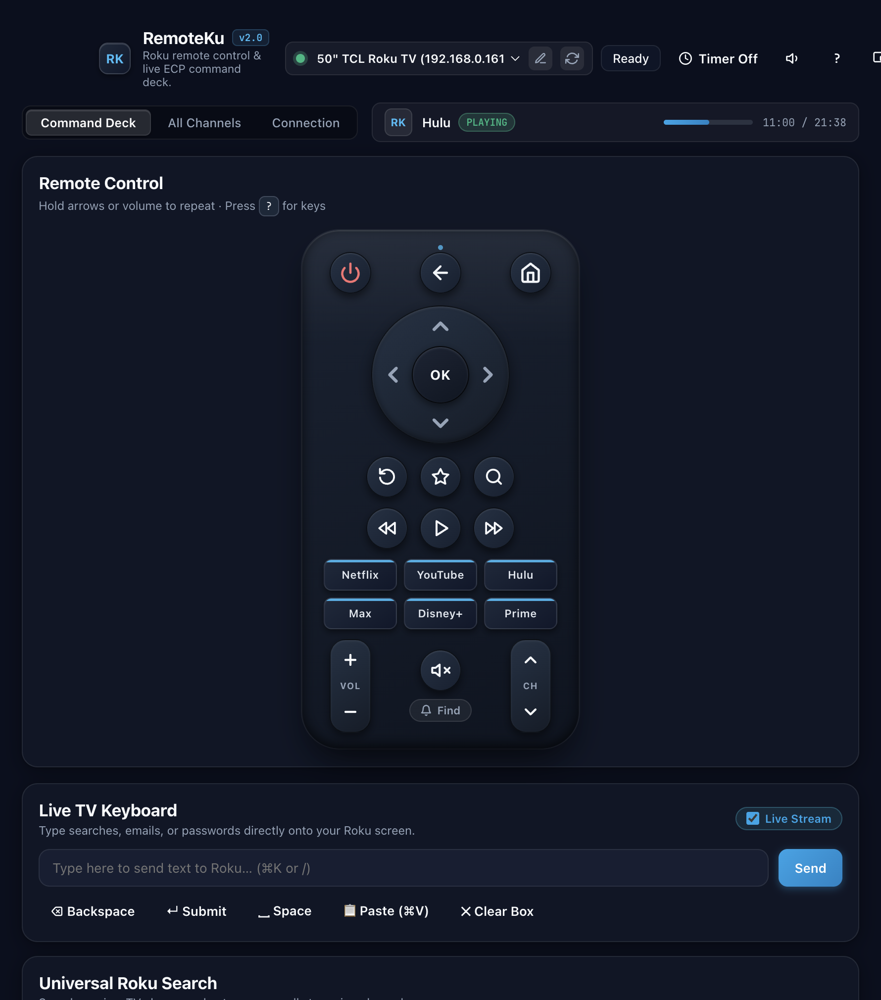
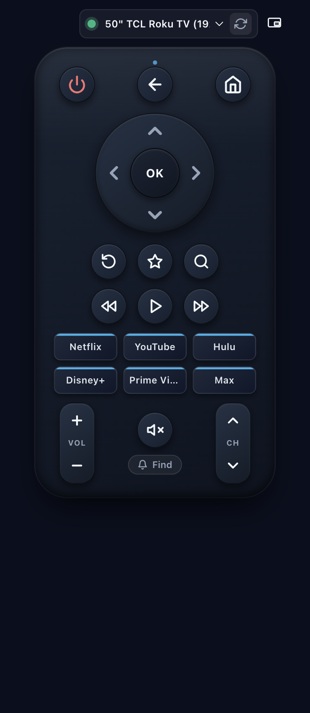

# RemoteKu v2.0 — Roku Remote & Live ECP Command Deck

A fast, hardware-modeled Roku remote control and live ECP command deck built for macOS, Windows, and Linux.

<p align="center">
  
</p>

---

## Download

Grab the latest release for your platform:

| Platform | Download | Architecture |
|----------|----------|--------------|
| **macOS (Apple Silicon)** | [RemoteKu-2.1.0-arm64.dmg](https://github.com/KevinOBytes/remoteku/releases/latest/download/RemoteKu-2.1.0-arm64.dmg) | Apple Silicon (M1/M2/M3/M4) |
| **macOS (Intel)** | [RemoteKu-2.1.0.dmg](https://github.com/KevinOBytes/remoteku/releases/latest/download/RemoteKu-2.1.0.dmg) | Intel 64-bit |
| **Windows** | [RemoteKu.Setup.2.1.0.exe](https://github.com/KevinOBytes/remoteku/releases/latest/download/RemoteKu.Setup.2.1.0.exe) | x64 |
| **Linux** | [RemoteKu-2.1.0.AppImage](https://github.com/KevinOBytes/remoteku/releases/latest/download/RemoteKu-2.1.0.AppImage) | x64 |

> [Browse all releases →](https://github.com/KevinOBytes/remoteku/releases)

---

## Install Instructions

### macOS (.dmg or Homebrew Cask)

**Via Homebrew Cask:**
```bash
brew install --cask https://raw.githubusercontent.com/KevinOBytes/remoteku/main/Casks/remoteku.rb
```

**Manual DMG:**
1. Download the `.dmg` file matching your Mac architecture from the table above.
2. Open the `.dmg` and drag **RemoteKu** into your **Applications** folder.
3. On first launch, macOS Gatekeeper may warn about an unsigned binary:
   - Open **System Settings → Privacy & Security**, scroll down, and click **"Open Anyway"**, or right-click the app in Finder → **Open**.
4. When prompted, allow RemoteKu access to your **Local Network** (**System Settings → Privacy & Security → Local Network**).

### Windows (.exe)

1. Download and run the `.exe` installer.
2. If Windows SmartScreen appears, click **"More info"** → **"Run anyway"**.

### Linux (.AppImage)

```bash
chmod +x RemoteKu-2.1.0.AppImage
./RemoteKu-2.1.0.AppImage
```

---

## What's New in v2.1

- **Universal Roku Search (`⌘⇧S`)**: Deep content search across all streaming channels directly from desktop using Roku's native `/search/browse` protocol.
- **Direct Clipboard Paste & Stream (`⌘V`)**: Stream passwords, URLs, or search text from your desktop clipboard straight onto the TV screen with automated newline sanitization.
- **Sleep Timer & Auto-Off Countdown**: Cycle through 15m, 30m, 45m, 60m, 90m, or Off with live badge countdowns and automated `PowerOff` transmission on expiration.
- **Trackpad / Mouse Wheel Volume Gesture**: Two-finger scroll over the tactile remote body smoothly steps TV volume up or down with responsive 130ms throttling and mechanical click feedback.
- **Custom Device Nicknames & Input Labels**: Rename multiple Roku devices (e.g. "Living Room TV") and customize HDMI 1–4, Tuner, and AV labels (e.g. "PS5", "Apple TV").
- **Universal macOS Packaging**: Full dual-architecture support for Apple Silicon (`arm64`) and Intel (`x64`) with deterministic LC_UUID patching and Homebrew Cask distribution.
- **In-App Update Checker**: Lightweight background check against GitHub Releases API on launch with subtle notification pills.

---

## What's New in v2.0

- **Floating Picture-in-Picture Mini Remote (`⌘⇧M`)**: Collapse the app into a sleek, compact pocket remote that floats beside your active windows without taking up screen real estate.
- **Side-by-Side Desktop Command Deck**: On desktop viewports, the hardware-modeled remote sits alongside a live **Companion Dock** featuring a **Live TV Keyboard**, **Searchable Channel Launcher**, and **Roku TV Input & Power Controls**.

<p align="center">
  
</p>
- **Live TV Keyboard (`Lit_<char>` Streaming)**: Type search queries, usernames, or passwords directly from your Mac/PC keyboard onto your Roku screen. Toggle **Live Stream** to transmit every character (including Backspace and Enter) in real time as you type, or send full strings at once.
- **Real Roku Channel Icons & Instant Search**: Automatically fetches and caches official channel artwork (`/query/icon/<appId>`) from your Roku device with instant search filtering.
- **Customizable Pinned App Shortcuts (`★`)**: Pin up to 6 of your favorite installed Roku channels (`★`) to customize the 6 physical shortcut buttons directly on the remote body.
- **Mechanical Audio Feedback & Physical Keyboard Control**: Synthesizes audible mechanical click feedback on button press and release (can be toggled in the header), and maps every remote action directly to your physical laptop keyboard (`W/A/S/D`, arrows, `Enter`, `Space`, `+`/`-`).
- **Live "Now Playing" Telemetry Bar**: Queries `/query/active-app` and `/query/media-player` to display the active channel, playback state (`PLAYING`, `PAUSED`, `SCREENSAVER`), live progress bar, and elapsed/total timecodes (`14:20 / 48:00`).
- **Press-and-Hold Repeat**: Hold down D-pad arrows (`Up`, `Down`, `Left`, `Right`), `Volume +/-`, `Channel +/-`, or `Rewind`/`Fast Forward` for continuous repeat.
- **Quick Header Device Switcher & <150ms Instant Reconnect**: Switch between multiple Rokus directly from the header pill (including inside **Mini Remote Mode**), and reconnect to your last-used Roku immediately on startup without waiting for SSDP multicast scans to finish.
- **First-Class macOS Integration**:
  - **Menu Bar Tray Icon**: Control playback, volume, power, or switch Roku devices directly from the macOS Menu Bar. Closing the window keeps RemoteKu ready in the menu bar.
  - **Global Summon Hotkey (`⌘⇧R` / `Ctrl+Shift+R`)**: Summon or hide RemoteKu from anywhere in your workflow.
  - **MacBook Touch Bar Support**: One-tap `Power`, `Home`, `Back`, `Play/Pause`, `Mute`, and `Volume` controls on the Touch Bar.
  - **Persistent Window Bounds**: Remembers your exact window size and position separately for Standard and Mini Remote modes, and automatically reconnects on Mac wake-from-sleep.
- **Offline Bundled Typography**: Ships with locally bundled **Space Grotesk**, **Plus Jakarta Sans**, and **JetBrains Mono** (`tabular-nums`) for crisp, zero-network-latency rendering.

---

## Keyboard Shortcuts

Press `?` or `⌘/` at any time inside the app to open the interactive Keyboard Shortcuts Cheat-Sheet.

| Shortcut | Action |
|----------|--------|
| `↑` `↓` `←` `→` or `W` `A` `S` `D` | Navigate D-Pad |
| `Enter` | Select / OK |
| `Space` or `K` | Play / Pause |
| `Backspace` or `Esc` | Back |
| `H` or `Home` | Roku Home Screen |
| `M` | Mute / Unmute |
| `+` / `-` | Volume Up / Down |
| `[` / `]` or `J` / `L` | Rewind / Fast Forward |
| `R` | Instant Replay |
| `I` or `*` | Options / Info (`*`) |
| `⌘K` / `Ctrl+K` or `/` | Focus Live TV Keyboard |
| `⌘V` / `Ctrl+V` | Paste & Stream Clipboard to TV |
| `⌘⇧S` / `Ctrl+Shift+S` | Focus Universal Roku Search |
| `⌘F` / `Ctrl+F` | Search Installed Channels |
| `⌘R` / `Ctrl+R` | Rescan Network for Roku Devices |
| `Scroll` | Trackpad / Mouse Scroll on Remote for Volume |
| `⌘⇧M` / `Ctrl+Shift+M` | Toggle Floating Mini Remote |
| `⌘⇧R` / `Ctrl+Shift+R` | Global Summon / Hide RemoteKu Window |

---

## Architecture & Security

- **[main.js](main.js)**: Electron main process managing `BrowserWindow`, macOS `Tray`, `Menu`, `TouchBar`, `globalShortcut`, `powerMonitor`, and IPC handlers.
- **[window-state.js](window-state.js)**: Persistent window bounds and user preference manager.
- **[preload.js](preload.js)**: Context-isolated `contextBridge` exposing `window.rokuAPI`.
- **[roku-client.js](roku-client.js)**: Roku ECP client supporting multi-interface SSDP discovery, smart physical-subnet fallback scanning, proxy-immune HTTP requests, retries, literal character encoding, icon caching, and live media telemetry.
- **[renderer-logic.js](renderer-logic.js)**: Pure, unit-tested domain logic for shortcut resolution, timecode formatting, host normalization, and favorite app pinning.
- **[renderer.js](renderer.js)**, **[index.html](index.html)**, **[styles.css](styles.css)**: Responsive Command Deck UI and Web Audio tactile feedback.

---

## Development

```bash
# Install dependencies
npm install

# Run in development
npm start

# Run unit tests
npm test

# Build macOS arm64 .dmg package
npm run build:mac
```

## License

ISC · Author: KevinOBytes
